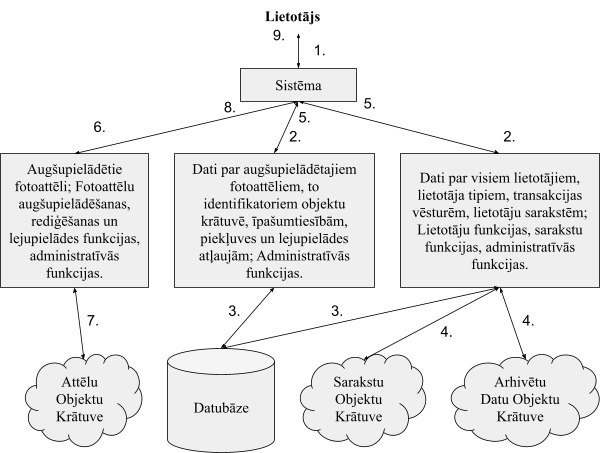
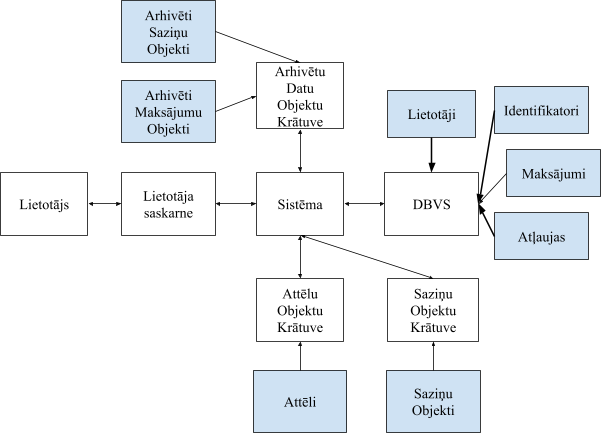
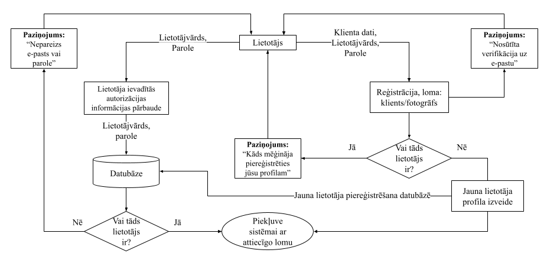
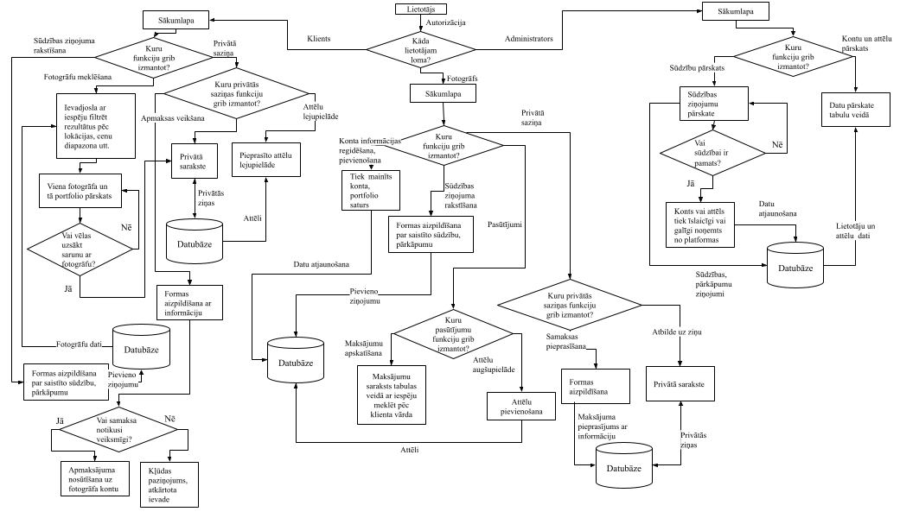
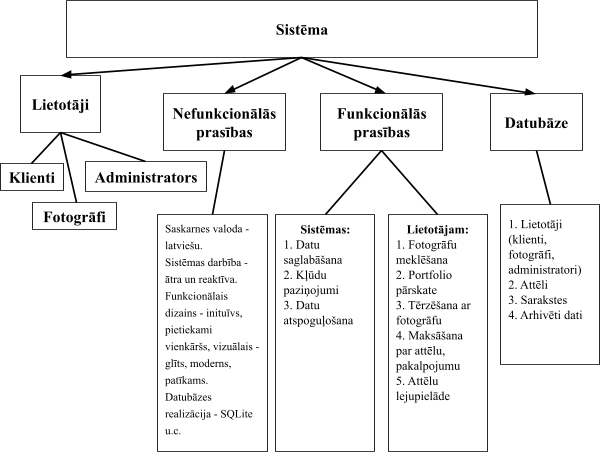

# Sistēmas prasību specifikācija

Fotogrāfu atrašanas un attēlu dalīšanās platforma

Grupa:  
Elans Raitums-Šāvējs  
Aigars Gerasimčiks  
Artūrs Helmanis  
Marta Stašāne  
Anna Stašāne

Rīga 2026

## 1. Sākotnējā izpēte

Meklējot problēmsfēras, kuras mēs varētu risināt, nonācām pie secinājuma, ka gan Latvijā, gan ārvalstīs, trūkst profesionālas vietnes vai aplikācijas, kas savienotu fotogrāfus ar viņu klientiem un vienlaicīgi nodrošinātu šo fotogrāfu fotoattēlu uzglabāšanu un dalīšanu. Visi eksistējošie risinājumi tikai daļēji izpilda kādu no šīm funkcijām, piemēram, attēlu uzglabāšana un dalīšana (Dropbox), vai fotogrāfu atrašana ([Find A Photographer](https://www.findaphotographer.com/)). Latvijā bieži vien tiek izmantota [failiem.lv](http://failiem.lv) platforma, kurā visbiežāk var piekļūt fotoattēliem bez paroļu ievadīšanas, kas izraisa drošības riskus.

## 2. Priekšmetiskās jomas apraksts

Projekta priekšmetiskā joma ir fotografēšanas pakalpojumu reklamēšana, digitālu fotoattēlu uzglabāšana un dalīšanās ar citiem. Programmatūra veidota kā vienota vietne, kur fotogrāfi var dalīties ar savu portfolio un prasmēm, reklamēt sevi un sniegt savus pakalpojumus jauniem klientiem. Savukārt, klienti var atrast savām vajadzībām piemērotākos fotogrāfus, pārskatīt to portfolio un uzsākt ar tiem sarunu, lai pieprasītu viņu pakalpojumus vienuviet, kā arī iegūt un lejupielādēt augstas kvalitātes attēlus savām vajadzībām.

Vietne ir pieejama tiešsaistē kā tīmekļa vietne. Lai tālak spētu pielietot vietnes funkcionalitāti, lietotājam vispirms ir jāautorizējas. Vietne veidota tā, lai tajā būtu viegli orientēties un atrast sev visu nepieciešamo, tās dizains ir moderns un intuitīvs, lai nodrošinātu ērtu platformas lietošanu un spētu atrisināt aprakstīto problēmu.

## 3. Vienkāršots sistēmas modelis

1\. attēls Vienkāršota sistēmas modeļa shēma

## 4. Sistēmas modeļa apraksts
1. Lietotājs ar lietotājvārdu un paroli piereģistrējas, autorizējas un pievienojas sistēmai.
2. Sistēma dod piekļuvi lietotāja datiem un funkcijām atkarībā no lietotāja lomas - lietotājs-klients, lietotājs-fotogrāfs un administrators. Administratoriem ir pieejamas arī papildus funkcijas.
3. Sistēma iegūst nepieciešamos datus par lietotājam piederīgo saturu. Tā rediģē vai pievieno jaunus datus ja tika izmantota atbilstošā funkcija.
4. Sistēma iegūst lietotājam piederīgo saziņu saturu un maksājumu vēsturi. Tā rediģē vai pievieno jaunus, ja tika izmantota atbilstošā funkcija.
5. Sistēma iegūst atjaunotos datus (par transakcijām, sarakstēm, lietotāja tipiem, utt.)
6. Sistēma dod piekļuvi lietotājam piederīgajiem attēliem.
7. Sistēma iegūst lietotājam piederīgos attēlus. Tā rediģē vai pievieno jaunus attēlus, ja tika izmantota atbilstošā funkcija.
8. Sistēma iegūst atjaunotos datus (par fotoattēliem).
9. Lietotājs saņem datus.
## 5. Sistēmas apkārtnes shēma

2\. attēls Sistēmas apkārtnes shēma

## 6. Sistēmas apkārtnes shēmas apraksts

Mijiedarbība lietotājam ar pārējo sistēmu notiek caur lietotāja saskarni. Pēc autorizācijas, kas nosaka lietotāja lomu, lietotājam ir piekļuve sistēmai un tās piedāvātajām funkcijām. Funkciju izpildīšanai sistēma mijiedarbojas ar datubāzi, kura satur informāciju par lietotājiem, aktīvajiem maksājumiem un lietotāju piekļuves atļaujām datiem. Kad ir saņemti dati par lietotājam atļautajiem datiem, tad sistēma sazinās ar objektu krātuvēm, kuras uzglabā attēlus, vēsturiskos maksājumus, saziņas, utt. Visi šie dati ir kriptēti. Dati tiek papildināti vai modificēti atkarībā no lietotāja darbībām. No datubāzes un krātuvēm modificētie vai atlasītie dati tiek nodoti programmai. Lietotājs redz vai saņem sev piederīgus datus caur saskarni.

## 7. Sistēmas prasības

7.1. Funkcionālās prasības.

1. Lietotāju klasifikācija.
1. Lietotājs-fotogrāfs.
2. Lietotājs-klients.
3. Lietotājs-administrators.
2. Lietotāja piekļuve sistēmai.
1. Lietotāja-klienta konta izveide - izveidot savu kontu var ievadot lietotājvārdu, paroli, e-pastu un tas tiek saglabāts datu bāzē.
2. Lietotāja-fotogrāfa konta izveide - lietotāja-fotogrāfa kontu iespējams izveidot, ja jau eksistē lietotāja-klienta konts. Lietotājs uziet uz iestatījumu sadaļu un izvēlas opciju “kļūt par fotogrāfu.” Lietotājam tiek piedāvāts aizpildīt vajadzīgās formas kā konta numuru, telefona numuru, dzīvesvietas adresi, vārdu un uzvārdu, utt. Ja dati ir pieņemami, konts tiek izveidots un pievienots datubāzei.
3. Lietotāja-administratora konta izveide - konta izveide iespējama tikai lokāli sistēmas administratora uzraudzībā.
4. Lietotāja autorizācija - ievadot lietotājvārdu un paroli, autorizē lietotāju.
5. Lietotāja-administratora autorizācija - administratīvai lietotājs atver speciālo mājaslapu un tam ir piekļuve, ja izpildās nosacījumi - lietotājs ir pieslēdzies lokālajam serverim ar VPN un datora MAC addrese ir atbalstīto datoru sarakstā vai arī lietotājs atrodas pie sistēmai lokāla datora. Pieslēgšanās ar lietotājvārdu, paroli un divu-faktoru autentifikāciju.
3. Funkcijas, kas pieejamas reģistrētam lietotājam.
1. Klients - fotogrāfu meklēšana. Lietotājs-klients spēj vadīt frāzes meklēšanas joslā vai filtrēt pēc fotogrāfa specializācijas, attēlu tipiem, pakalpojuma cenu diapazona, fotogrāfa lokācijas. Spēj apskatīt piedāvātos rezultātus.
2. Klients - fotogrāfa konta (informācijas) un portfolio pārskats. Lietotājs-klients spēj atvērt atrasto fotogrāfu profilus, lai apskatīt visu pieejamo informāciju par fotogrāfu un tā portfolio.
3. Klients - saziņa ar fotogrāfu. Lietotājs-klients spēj uzsākt tērzētavas sarunu ar fotogrāfu.
4. Klients - sūdzības ziņojuma veikšana. Lietotājs-klients var iesniegt ziņojumu pret fotogrāfu privāto saziņu rakstura dēļ, profila vai portfolio satura pārkāpuma vai krāpnieciskas rīcības gadījumā.
5. Klients - samaksa par pakalpojumu. Lietotājs-klients spēj veikt samaksu par sarunato vai saņemto pakalpojumu un iegūst piekļuvi attēliem.
6. Klients - apmaksāto attēlu lejupielāde. Lietotājs-klients spēj lejupielādēt attēlus, individuāli vai lielos daudzumos vairākus kopā, kurus ir augšupielādējis fotogrāfs un par kuriem ir samaksāts.
7. Fotogrāfs - pievienot un rediģēt savu aprakstu, informāciju par sniegtajiem pakalpojumiem. Lietotājs-fotogrāfs spēj atjaunot datus par savu kontu, pievienojot, mainot savu aprakstu un datus, kas saistīti ar pakalpojumu.
8. Fotogrāfs - augšuplādēt attēlus portfolio. Lietotājs-fotogrāfs spēj augšupielādēt jaunus fotoattēlus uz savā profilā redzamo portfolio.
9. Fotogrāfs - saņemt ziņas no klientiem. Lietotājs-fotogrāfs var saņemt ziņas no klientiem un turpināt tērzētavu sarunas.
10. Fotogrāfs - sūdzības ziņojuma veikšana. Lietotājs-fotogrāfs var iesniegt ziņojumu pret klientu privāto sarunu rakstura dēļ un krāpnieciskas rīcības gadījumā.
11. Fotogrāfs - pieprasīt samaksu par pakalpojumu. Lietotājs-fotogrāfs spēj pieprasīt klientam veikt maksājumu pirms vai pēc pakalpojuma sniegšanas.
12. Fotogrāfs - saņemt samaksu par sniegto pakalpojumu. Lietotājs-fotogrāfs var saņemt samaksu par individuāli sniegto pakalpojumu.
13. Administrators - piekļuve datu bāzei un objektu krātuvēm. Administrators spēj redzēt kriptēto datu metadatus, pārformatēt datu bāzi un objektu krātuvi un veikt nepieciešamās uzturēšanas darbības.
14. Administrators - sūdzību ziņojumu pārraudzība. Administrators spēj apskatīt iesniegtos ziņojumus par citiem lietotājiem vai publicēto saturu un izvērtēt tālāko rīcības plānu.
15. Administrators - lietotāju īslaicīga konta darbības apturēšana vai pilnīga noņemšana no platformas. Administrators, pēc sniegto ziņojumu izvērtēšanas, var pārtraukt fotogrāfa vai klienta darbību īslaicīgi vai pilnīgi.
16. Administrators - lietotāja publicētā satura īslaicīga vai pilnīga noņemšana no platformas. Administrators, pēc sniegto ziņojumu izvērtēšanas, var noņemt fotogrāfa attēlu no platformas vai nu īslaicīgi vai pilnīgi.
17. Visiem - redzēt vietnes saturu. Ienākot vietnē var redzēt pamatsaturu, kā fotogrāfu portfolio, publiskos profilus, meklēšanas joslu, sadaļa - jaunu fotogrāfu un viņu portfolio apskats, vietnes dizaina formatējumu utt.
18. Fotogrāfs - apraksts nevar pārsniegt 250 rakstzīmes.
19. Fotogrāfs - nedrīkst augšupielādēt failus, kas nav no atļautajiem attēlu tipiem (JPEG, PNG, utt.)
20. Fotogrāfs - vienlaikus apstrādāto augšupielāžu daudzums ir limitēts uz 10 attēliem. Fotogrāfs var izvēlēties augšupielādēt vairāk failus, bet sistēma to augšupielādi sadalīs šī limita robežās.
21. Klients/Fotogrāfs - vienlaikus apstrādāto lejupielāžu daudzums ir limitēts uz 10 attēliem. Lietotājs var izvēlēties lejupielādēt vairāk failus, bet sistēmu to lejupielādi sadalīs šī limita robežās.

7.2. Nefunkcionālās prasības.

1. Vietnes (produkta) prasības.
1. Sistēmas saskarnes valoda - latviešu.
2. Sistēmas darbība - sistēmai jābūt ātrai un reaktīvai.
3. Sistēmas drošība - privātai un drošai, nekriptētu datu noplūde nav pieļaujama.
4. Sistēmas stabilitāte - duplicētas datu glabātavas dažādos serveros. Datu zaudēšana nav pieļaujama.
5. Funkcionālais dizains - inituīvs, pietiekami vienkāršs.
6. Vizuālais dizains - glīts, moderns, patīkams.
2. Procesa prasības.
1. Sistēmas izstrādes valodas - HTML, CSS, JavaScript, SQL, Python.
2. Satvars (Framework) - [Python's Django](https://www.djangoproject.com/)
3. Datubāzes realizācija - [SQLite](https://sqlite.org/)
4. Objektu krātuves realizācija - [Silo](https://github.com/pgsty/silo) (aktīvi uzturēts [MinIO](https://github.com/minio/minio) atzars)
5. Pieejamās platformas - tīmekļa saite datoriem un mobīlajām ierīcēm.
6. Izpildes termiņs - kursa beigas.
## 8. Darbību diagrammas

8.1. Lietotāju reģistrācija, autorizācija

3\. attēls. Autorizācijas/reģistrācijas procesa shēma

8.2. Programmas funkciju darbība

4\. attēls. Programmas funkciju darbības shēma

## 9. Viedokļu tabulārās diagrammas

9.1. Sistēmas viedoklis

| Avots | Ieeja | Darbība | Iznākums | Norīkojuma vieta |
| --- | --- | --- | --- | --- |
| Lietotājs | Lietotāja registrācijas informācija: • lietotājvārds • vārds • uzvārds • parole • e-pasts • maksājumu informācija • lietotāja tips: • pakalpojumu sniedzējs (fotogrāfs) • pakalpojumu saņēmējs (klients) • sistēmas administrators | Lietotāja reģistrācija datubāzē | • Lietotāja konta izveidošana • Kļūdas paziņojums | Ekrāns, Datubāze |
| Lietotājs | Lietotāja autorizācijas informācija: • lietotājvārds • parole | Lietotāja autorizācija | • Lietotāja piekļuve sistēmai • Kļūdas paziņojums | Ekrāns |

9.2. Lietotāja-fotogrāfa viedoklis.

| Avots | Ieeja | Darbība | Iznākums | Norīkojuma vieta |
| --- | --- | --- | --- | --- |
| Fotogrāfs | Jauna fotogrāfa konta dati: • lietotājvārds • vārds • uzvārds • parole • e-pasts • maksājumu informācija | Jauna fotogrāfa konta izveide | • Tiek reģistrēts jauns fotogrāfa konts • Kļūdas paziņojums | Ekrāns, Datubāze |
| Fotogrāfs | Jauna attēla dati: • attēls • nosaukums/ tituls • attēla formāts • attēla kategorija (pēc sižeta) • attēla aizsardzības veids • papildinformācija par attēlu (nav obligāta): • uzņemšanas vieta • apraksts | Jauna attēla augšuplāde priekš porfolio vai pakalpojuma | • Attēls tiek aizsargāts ar ūdenszīmi/ pret MI filtru un pievienots portfolio • Attēls tiek aukšupielādēs pieļuvei klientam • Kļūdas paziņojums | Ekrāns, Datubāze |
| Fotogrāfs | Atlasītais attēls | Attēla dzēšana no platformas | • Attēls noņemts no portfolio • Kļūdas paziņojums | Ekrāns, Datubāze |
| Fotogrāfs | Klienta ziņa | Ziņas saņemšana un saziņa ar klientu caur tērzētavu | • Fotogrāfs var redzēt, saņemt ziņu no kienta un var tam atbildēt • Kļūdas ziņojums | Ekrāns |
| Fotogrāfs | Profila informācija: • apraksts • specializācija • lokācija • cena par pakalpojumu | Profila informācijas aizpildīšana, atjaunināšana | • Aizpildīts, atjaunināts profils ar informāciju • Kļūdas ziņojums | Ekrāns, Datubāze |

9.3. Lietotāja-klienta viedoklis.

| Avots | Ieeja | Darbība | Iznākums | Norīkojuma vieta |
| --- | --- | --- | --- | --- |
| Klients | Meklēšanas kritēriji | Fotogrāfu meklēšana pēc kritērījiem | • Lietotājs var atrast fotogrāfu, kas atbilsti viņa vajadzībāmi | Ekrāns |
| Klients | Izvēlētā fotogrāfa profils | Fotogrāfa profila un portfolio apskate | • Lietotājam ir pieejama informācija par fotogrāfu un tā portfolio saturs | Ekrāns |
| Klients | Īsziņa | Saziņa ar fotogrāfu | • Lietotājs var sūtīt un saņemt ziņas no fotogrāfa | Ekrāns |
| Klients | Fotogrāfa bankas dati | Apmaksas veikšana par pakalpojumu | • Klients veic apmaksu par pakalpojumu vai attēlu | Ekrāns |
| Klients | Izvēlētais attēls | Attēla lejupielāde | • Attēla lejupielāde uz lietotāja ierīci | Ekrāns, Datubāze |

9.4. Administratora viedoklis

| Avots | Ieeja | Darbība | Iznākums | Norīkojuma vieta |
| --- | --- | --- | --- | --- |
| Administrators | Nav | Lietotāju pārskate | • Administrators spēj pārskatīt lietotāju kontu sarakstu. | Ekrāns, Datubāze |
| Administrators | Ziņojums par neatbilstošu saturu, kontu. | Ziņojumu pārskatīšana | • Administrators pieņem lēmumu par lietotāja konta dzēšanu vai satura blokēšanu, novākšanu. no platformas | Ekrāns, Datubāze |
| Administrators | Izvēlētais lietotājs | Lietotāja konta blokēšana vai dzēšana | • Lietotāja konts tiek blokēts vai dzēsts | Ekrāns, Datubāze |
| Administrators | Izvēlētais attēls | Attēlu dzēšana | • Neatbilstošs vai noteikumu pārkāpjošs attēls tiek noņemts no platformas | Ekrāns, Datubāze |

## 10. Viedokļu hierarhiskā diagramma

5\. attēls. Viedokļu hierarhiskā diagramma

Tika izpētīta priekšmetiskā joma. Iegūto informāciju var sadalīt viedokļos, kuri aptver

sfēras, kā:

- Viedokļi par lietotājiem un to klasēm - klienti, fotogrāfi un administratori -, kuriem ir savas iespējas un funkcijas;
- Viedokļi par nefunkcionālajām prasībām;
- Viedokļi par funkcionālajām prasībām: sistēmas funkcijām un lietotājiem pieejamām funkcijām;
- Viedokļi par datubāzi un tās glabājamiem objektiem
