# Sistēmas projektējums

Fotogrāfu atrašanas un attēlu dalīšanās platforma

Grupa:  
Elans Raitums-Šāvējs  
Aigars Gerasimčiks  
Artūrs Helmanis  
Marta Stašāne  
Anna Stašāne

## 1. Ievads

### 1.1. Nolūks

Dokuments satur fotogrāfu atrašanas un attēlu dalīšanās platformas sistēmas darbības un struktūras aprakstu. Dokuments, galvenokārt, paredzēts sistēmas izstrādātājiem un testētājiem, ar nolūku sniegt realizējamu aprakstu, kas iegūts no prasību specifikācijas.

### 1.2. Darbības sfēra

Sistēma tiek izstrādāta ar mērķi nodrošināt vietu fotogrāfiem, kur var dalīties ar savu portfolio un prasmēm, reklamēt sevi un sniegt savus pakalpojumus, un klientiem, kuri var atrast savām vajadzībām piemērotākos fotogrāfus, pārskatīt portfoli, uzsākt sarunu ar fotogrāfiem, kā arī iegūt un lejupielādēt augstas kvalitātes attēlus.

Par datubāzē un objektu krātuvē pieejamo informācija ir atbidīgi:

- Administratori, kuriem ir iespēja pārvaldīt (dzēst, bloķēt, atjaunot) datus, uzturēt sistēmu atjauninātu, veikt labošanas darbus.
- Lietotāji, kuriem ir iespēja izveidot savus profilus, attiecībā no lomas, augšupielādēt vai lejupielādēt attēlus un veidot saziņu ar citiem lietotājiem.

Informācija - personīgie dati, maksājumi, attēli, saziņa.

Sistēma ir paredzēta fotogrāfiem un klientiem - cilvēkiem, kam nepieciešama fotogrāfa pakalpojumi.

### 1.3. Definīcijas un saīsinājumi

| Termins                | Termina skaidrojums                                                                                                                                                          |
| ---------------------- | ---------------------------------------------------------------------------------------------------------------------------------------------------------------------------- |
| Administrators         | Vietnes īpašnieks un pārraudzītājs, kurš ir atbildīgs par vietnes darbības, datu bāzes un datu krātuves uzturēšanu. Tam ir pieejamas administratīvas pilnvaras un funkcijas. |
| Lietotājs              | Vietnes lietotājs, kas var ieņemt vienu no 2 lomām - fotogrāfs, klients. Šīs lomas var sazināties savā starpā caur tērzētavu.                                                |
| Fotogrāfs              | Lietotāja loma, var veidot sev personīgu profilu, augšupielādēt bildes un reklamēt sevi un savus servisus iespējamiem klientiem, kā arī sazināties ar tiem.                  |
| Klients                | Lietotāja loma, sazināties caur tērzētavu ar fotogrāfiem par to iespējamiem pakalpojumiem, var iepirkt bildes un lejupielādēt tās.                                           |
| Portfolio              | Fotogrāfa augšupielādēto bilžu kopums, kuras fotogrāfs ir izvēlējies, lai atrādītu savu darbu un piesaistītu klientus.                                                       |
| Projektējuma dokuments | Dokuments, kurā ir aprakstīta sistēmas struktūra un darbība. Sekojot šai dokumentācijai, tiek realizēta programma, kas atbilst pasūtītāja prasībām.                          |
| SQL                    | Standarta valoda datubāžu satura manipulācijai un glabāšanai.                                                                                                                |
| Dekompozīcija          | Sistēmas un tās procesu sadalīšana sastāvdaļās.                                                                                                                              |
| Modulis                | Sistēmas vai programmas daļa, kura satur noteiktu veselās sistēmas funkciju un kura spēj darboties ar citām saistītām daļām.                                                 |
| Process                | Sistēmas ietvaros identificējama datu apstrādes specifiska darbību secība ar identificētu sākuma stāvokli un iespējamiem beigu stāvokļiem.                                   |
| Datubāze               | Uzglabā datus par lietotājiem, to profiliem un lomām, attēlu, arhivēto transakciju un sarunu identifikātoriem objektu krātuvē un nesenajām transakcijām.                     |
| Objektu krātuve        | Datu glabātuve, kura glabā datus objektu formātā. Uzglabā attēlus, saziņas, arhivētas transakcijas.                                                                          |

### 1.4. Saistība ar citiem dokumentiem

Par dokumenta pamatu tiek izmantota iepriekš izveidotā prasību specifikācija, kas ietver visas galvenās sadaļas, no kurām tiek izveidots realizējams apraksts, kas tiks nodots sistēmas izstrādātājiem un testētājiem.

## 2. Dekompozīcijas apraksts

### 2.1. Moduļu dekompozīcija

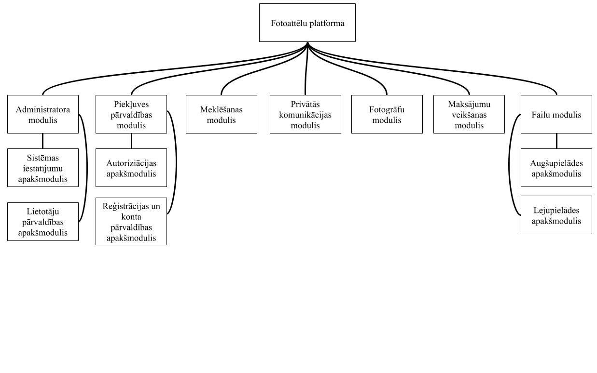

1. attēls. Moduļu dekompozīcijas shēma

#### 2.1.1. Moduļu dekompozīcijas uzskaitījums

| Nosaukums | Administratora modulis |
| --- | --- |
| Tips | Administratora modulis |
| Nolūks | Apakšmoduļa izvēle |
| Funkcija | Atkarībā no nepieciešamas funkcionalitātes izvēlas atbilstošo apakšmoduli. |

| Nosaukums | Sistēmas iestatījumu apakšmodulis |
| --- | --- |
| Tips | Administratora modulis |
| Nolūks | Sistēmas pārvaldība un uzturēšana |
| Funkcija | Uzraudzīt un uzturēt datu bāzi, nodrošināt vietnes funkcionalitāti, regulāri atjauninot vietni, tās funkcijas. Sekot vietnes drošībai. |

| Nosaukums | Lietotāju pārvaldības apakšmodulis |
| --- | --- |
| Tips | Administratora modulis |
| Nolūks | Vietnes pārvaldība un uzturēšana |
| Funkcija | Sūdzības ziņojumu izskatīšana par lietotājiem vai publicēto saturu, attiecīgu darbību veikšana, piemēram, lietotāja konta blokēšana, attēlu noņemšana no vietnes, lai uzturētu lietotāju drošību. |

| Nosaukums | Piekļuves pārvaldības modulis |
| --- | --- |
| Tips | Piekļuves pārvaldības modulis |
| Nolūks | Apakšmoduļa izvēle |
| Funkcija | Atkarībā no nepieciešamās funkcionalitātes izvēlas atbilstošo apakšmoduli. |

| Nosaukums | Autorizācijas apakšmodulis |
| --- | --- |
| Tips | Piekļuves pārvaldības modulis |
| Nolūks | Lietotāju autorizācija |
| Funkcija | Atkarībā no personas ievadītā lietotājvārda un paroles dod vai nedod piekļuvi sistemai. |

| Nosaukums | Reģistrācijas un konta pārvaldības apakšmodulis |
| --- | --- |
| Tips | Piekļuves pārvaldības modulis |
| Nolūks | Lietotāju reģistrācija |
| Funkcija | Izveidot lietotāja kontu, balstoties uz lietotāja sniegto personīgo informāciju un lomas izvēli. Nodrošināt lietotāja konta dzēšanas iespējas. |

| Nosaukums | Meklēšanas modulis |
| --- | --- |
| Tips | Meklēšanas modulis |
| Nolūks | Fotogrāfu meklēšana |
| Funkcija | Meklēt fotogrāfus pēc atlasītajiem parametriem. |

| Nosaukums | Privātās komunikācijas modulis |
| --- | --- |
| Tips | Privātās komunikācijas modulis |
| Nolūks | Komunikācija starp lietotājiem |
| Funkcija | Nodrošināt privātu saziņu starp fotogrāfirm un klientiem caur tērzētavu. |

| Nosaukums | Fotogrāfu modulis |
| --- | --- |
| Tips | Fotogrāfu modulis |
| Nolūks | Lomas profila personalizēšana |
| Funkcija | Pievienot, rediģēt vai dzēst fotogrāfa portfolio un profila saturu. |

| Nosaukums | Maksājumu veikšanas modulis |
| --- | --- |
| Tips | Maksājumu veikšanas modulis |
| Nolūks | Pakalpojuma apmaksa |
| Funkcija | Attēlu apmaksas nodrošināšana, maksājuma veida atlase, pārbaude ar banku, monetārās transakcijas izpildīšana un piefiksēšana, informācijas saglabāšana datu bāzē. |

| Nosaukums | Failu modulis |
| --- | --- |
| Tips | Failu modulis |
| Nolūks | Apakšmoduļa izvēle |
| Funkcija | Atkarībā no nepieciešamās funkcionalitātes izvēlas atbilstošo apakšmoduli. |

| Nosaukums | Augšupielādes apakšmodulis |
| --- | --- |
| Tips | Failu modulis |
| Nolūks | Failu augšupielāde |
| Funkcija | Viena vai vairākus failu atlase, aprakstošas informācijas pielikšana klāt un to augšupielādēšana uz vietni, lai citi lietotāji attēlus var redzet. Datu nosūtīšana uz datubāzi. |

| Nosaukums | Lejupielādes apakšmodulis |
| --- | --- |
| Tips | Failu modulis |
| Nolūks | Failu lejupielāde |
| Funkcija | Pēc pirkuma viena vai vairāku attēlu lejupielāde, datu saņemšana no datu bāzes. |

#### 2.1.2. Procesu dekompozīcijas uzskaitījums

| **Administratora modulis** |   |
| --- | --- |
| Procesa nosaukums | Procesa apraksts |
| Apakšmoduļa izvēle | Administrators atkarībā no nepieciešamas funkcionalitātes izvēlas atbilstošo apakšmoduli. |
| **Sistēmas iestatījumu apakšmodulis** |   |
| Procesa nosaukums | Procesa apraksts |
| Datu bāzes un objektu krātuves uzturēšana un uzraudzīšana | Administrators uzrauga un pārbauda datu bāzes un objektu krātuves darbību, nepieciešamības gadījumā veicu uzturēšanas darbības. |
| Sistēmas drošības uzraudzīšana | Regulāri pārbauda sistēmas darbību un saņemtos ziņojumus no sistēmas. |
| Vietnes funkcionalitātes uzturēšana, atjaunināšana | Administrators veic platformas funkciju un sistēmas komponenšu atjaunināšanu, lai nodrošinātu pareizu un nepārtrauktu sistēmas darbību. |
| **Lietotāju pārvaldības apakšmodulis** |   |
| Procesa nosaukums | Procesa apraksts |
| Ziņojumu saņemšana un pārskate | Pārskata saņemtos ziņojumus par lietotāja uzvedību vai neatļautu darbību veikšanu, augšupielādētā satura neatbilstību noteikumiem, utt. Pārbauda un izvērtē tālākās rīcības. |
| Lietotāja informācijas apskate | Pēc administratora pieprasījuma no datubāzes ar SQL vaicājumu vai Django Python skriptiem iegūst lietotāja informāciju un izvada to uz ekrāna. |
| Lietotāju konta īslaicīga darbības apturēšana | Pēc sūdzības ziņojuma izvērtēšanas lietotāja konta darbība tiek īslaicīgi apturēta uz noteiktu termiņu. Lietotājs saņem brīdinājumu, tas nedrīkst uzsākt tērzētavas sarunas, pieprasīt pakalpojumu vai lejuplādēt attēlus līdz termiņa beigām. |
| Lietotāju konta noņemšana/dzēšana no platformas | Pēc sūdzības ziņojuma izvērtēšanas lietotāja konts tiek likvidēts no platformas. Lietotājs saņem ziņojumu ar skaidrojumu. Lietotāja dati no datubāzes tiek izdzēsti. |
| Lietotāja satura īslaicīga blokēšana | Pēc sūdzības ziņojuma izvērtēšanas fotogrāfa publicētais attēls kļūst uz noteiktu termiņu nepieejams. Fotogrāfs saņem ziņojumu. Šajā laikā attēlu neviens nespēj apskatīt vai lejupielādēt. Tobrīd ziņojums atkal tiek izskatīts. Ja sūdzībai nav bijis pamats, tad attēls tiek atjaunots. |
| Lietotāja satura pilnīga noņemšana/dzēšana no platformas | Pēc sūdzības ziņojuma izvērtēšanas fotogrāfa publicētais attēls tiek pilnīgi noņemts no platformas. Visi dati par attēlu tiek neatgriezeniski dzēsti, fotogrāfs saņem brīdinājumu. |
| Konta darbības atjaunošana | Pēc konta darbības apturēšanas perioda beigām vai administratora izvēles lietotāja konta darbība tiek atjaunota. |
| Attēla atjaunošana | Pēc attēla pieejamības apturēšanas perioda beigās vai administratora izvēles lietotāja publicētais attēls tiek atjaunots. |

| **Piekļuves pārvaldības modulis** |   |
| --- | --- |
| Procesa nosaukums | Procesa apraksts |
| Apakšmoduļa izvēle | Lietotājs atkarībā no nepieciešamās funkcionalitātes izvēlās atbilstošo apakšmoduli. |
| **Autorizācijas apakšmodulis** |   |
| Procesa nosaukums | Procesa apraksts |
| Lietotāja autorizācija | Tiek pārbaudīta lietotāja eksistēšana datubāzē, tā lietotājvārds un parole un tiek vai netiek piešķirta piekļuve sistēmai kā lietotājam. |
| **Reģistrācijas un konta pārvaldības apakšmodulis** |   |
| Procesa nosaukums | Procesa apraksts |
| Lietotāja reģistrācija | Tiek pārbaudīta lietotāja ievadītā informācija, un, ja visa nepieciešamā informācija ir norādīta korekti, tiek izveidots lietotāja konts un veikti ieraksti datubāzē, lai lietotājs spētu pieslēgties sistēmai. |
| Lietotāja konta dzēšana | Lietotāja konta un ar to saistītās informācijas dzēšana no vietnes un datubāzes. |

| **Meklēšanas modulis** |   |
| --- | --- |
| Procesa nosaukums | Procesa apraksts |
| Fotogrāfu meklēšana | Meklē fotogrāfus pēc lietotāja ievadītajiem parametriem un atrāda atbilstošos rezultātus uz ekrāna. |
| Fotogrāfu filtrēšana | Lietojot konkrētus filtrus precizē meklēto fotogrāfu rezultātus. |
| Rezultātu apskate | Lietotājam uz ekrāna parādās fotogrāfu profili. Profili attēlo fotogrāfa portretu, īsu aprakstu un tā specialitātes. |
| Fotogrāfa profila un portfolio apskate | Pēc lietotāja izvēlēta fotogrāfa no datubāzes iegūst tā profila informāciju un fotogrāfa izveidoto portfolio, un attēlo to uz ekrāna. |

| **Privātās komunikācijas modulis** |   |
| --- | --- |
| Procesa nosaukums | Procesa apraksts |
| Saziņas atlase | Pēc fotogrāfa izvēles var no profila atlasīt iespēju uzsākt sarunu. |
| Tērzētavas saziņa | Ziņu starp fotogrāfu un klientu sūtīšana un saņemšana savā starpā. Datu kriptēšana, transkripcijas saglabāšana datubāzē. |
| Ziņojumu iesniegšana | Lietotājs, fotogrāfs vai klients, var iesniegt sūdzības ziņojumu pret otru, kas tiek nosūtīts uz datubāzi administratora vēlākai apstrādei. |
| Pakalpojuma attēla augšupielāde | Fotogrāfs saziņas vidē var augšupielādet attēlu par pakalpojuma veikšanu, iesākt maksājuma procesu. |
| Maksājumu pieprasīšana | Fotogrāfam un klientam vienojoties par fotogrāfa pakalpojumiem, fotogrāfs var iesūtīt naudas pieprasījumu privātajā saziņā. |

| **Fotogrāfu modulis**         |                                                                                                                                                                    |
| ----------------------------- | ------------------------------------------------------------------------------------------------------------------------------------------------------------------ |
| Procesa nosaukums             | Procesa apraksts                                                                                                                                                   |
| Publiskā profila apskatīšana  | Var redzēt profila un portfolio pašreizējo izskatu.                                                                                                                |
| Profila satura pievienošana   | Ļaut pievienot profilam aprakstu, profilbildi, kontaktinformāciju (e-pasts), saiti uz ārējām vietnēm (piem. Instagram, Facebook utt.). Datu nosūtīšana datu bāzei. |
| Profila satura labošana       | Profila apraksta, profilbildes, kontaktinformācijas un ārējo saišu labošana, informācijas atjaunošana un saglabāšana. Atjaunoto datu nodošana datu bāzei.          |
| Profila satura noņemšana      | Profila apraksta, profilbildes, kontaktinformācijas un ārējo saišu noņemšana no profila un datu bāzes.                                                             |
| Portfolio satura pievienošana | Attēlu, attēla papildinformācijas (nosaukums, apraksts, utt.) pievienošana profila portfolio. Datu nosūtīšana datubāzei.                                           |
| Portfolio satura labošana     | Attēla papildinformācijas labošana pēc augšupielādes. Atjaunoto datu nodošana datu bāzei.                                                                          |
| Portfolio satura dzēšana      | Attēlu un ar to saistītās informācijas dzēšana no vietnes profila un datu bāzes.                                                                                   |

| **Maksājumu veikšanas modulis** |   |
| --- | --- |
| Procesa nosaukums | Procesa apraksts |
| Maksājuma veida atlase | Atlase vienu no piedāvātajiem apmaksas veidiem, izvēlas konkrētu banku/karti. |
| Informācijas ievade | Maksājuma informācijas ievade attiecīgajos ievadlaukos, tās saglabāšana, lai nevajadzētu veikt atkārtotu ievadi. |
| Samaksas veikšana | Apstiprinot pirkumu, ievadītās informācijas pārbaude, savienošanās ar banku, bankas puses pārbaude par maksājumu. Paziņojuma izvadīšana par veiksmīgu pirkumu vai kļūdu. |
| Pirkuma reģistrācija | Pirkuma un ar to saistīto attiecīgo datu nosūtīšana un saglabāšana datu bāzē. |

| **Failu modulis** |   |
| --- | --- |
| Procesa nosaukums | Procesa apraksts |
| Apakšmoduļa izvēle | Atkarībā no nepieciešamās funkcionalitātes izvēlas atbilstošo apakšmoduli. |
| **Augšupielādes apakšmodulis** |   |
| Procesa nosaukums | Procesa apraksts |
| Attēlu augšupielāde | Augšupielādē attēlu, kriptē datus un nosūta attēlu un ar to saistīto informāciju uz datu bāzi. |
| **Lejupielādes apakšmodulis** |   |
| Procesa nosaukums | Procesa apraksts |
| Attēlu lejupielāde | Atrod pieprasītos datus datu bāzē, dekriptē tos un nodod tos tālāk kā lejupielādējamu failu vai mapi. |

### 2.2. Datu dekompozīcija

| Datubāzes tabulas nosaukums | Tabulas apraksts |
| --- | --- |
| Lietotāji | Glabā informāciju par lietotājiem neatkarīgi no to lomas. |
| Klienti | Glabā lietotāju-klientu datus |
| Fotogrāfi | Glabā lietotāju-fotogrāfu datus |
| Attēli | Glabā fotogrāfu augšupielādēto attēlu datus. |
| Ziņojumi | Glāba lietotāju iesniegtos ziņojumus par attēlu neatbilstošu saturu, lietotāju rīcību. |
| Maksājumi | Glabā datus par izsniegtajiem rēķiniem un veiktajiem maksājumiem |
| Sarunas | Glabā informāciju par lietotāju sarunām |
| Administratori | Glabā informāciju par administratoriem |

## 3. Atkarību apraksts

### 3.1. Starpmoduļu atkarības

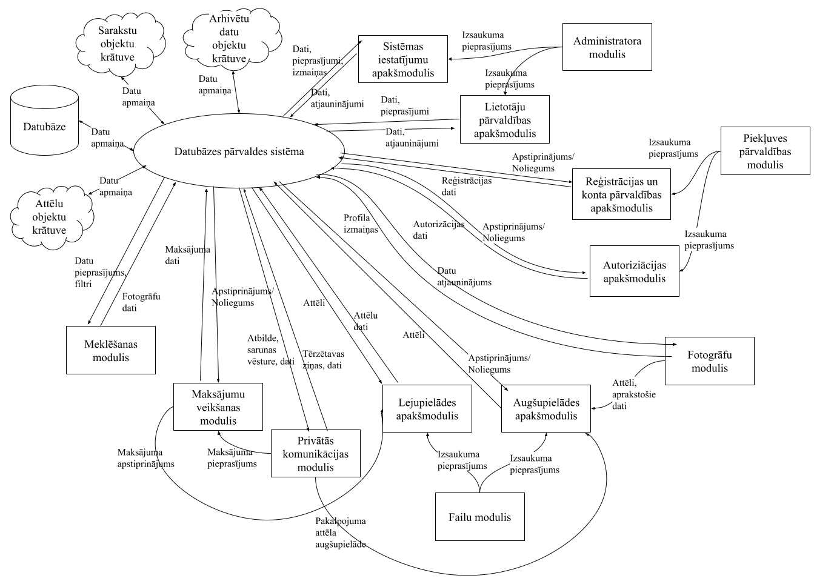

2. attēls. Starpmoduļu atkarību diagramma

### 3.2. Starpprocesu atkarības

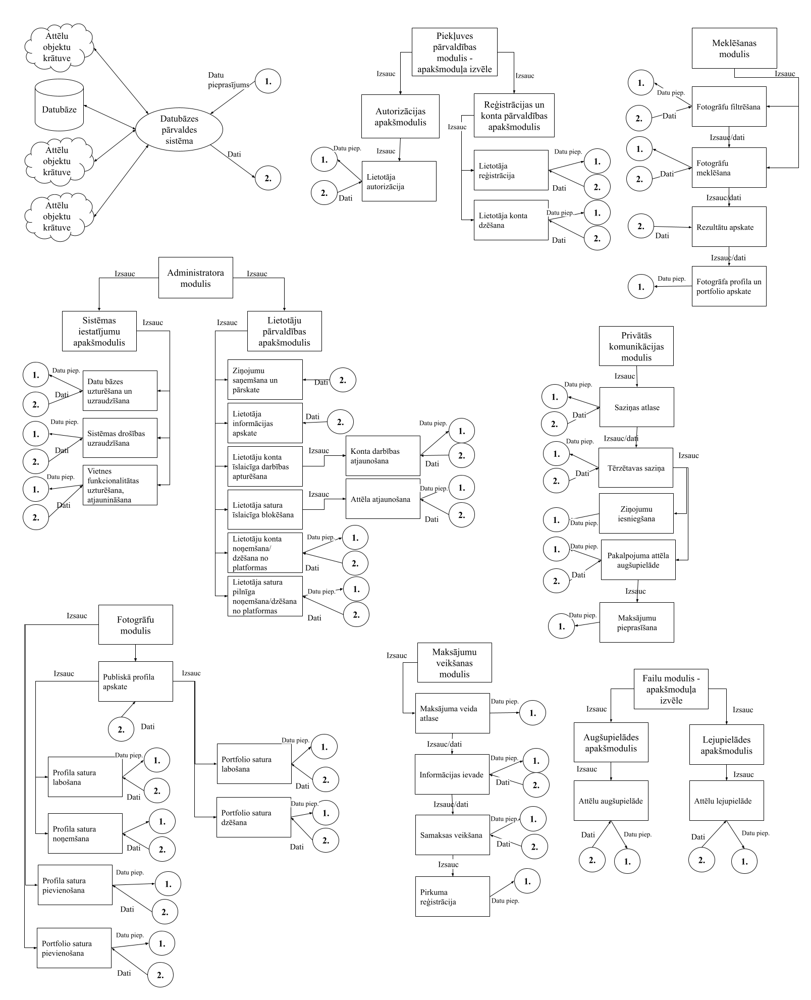

3. attēls. Starpprocesu atkarību diagramma

### 3.3. Datu atkarības apraksts

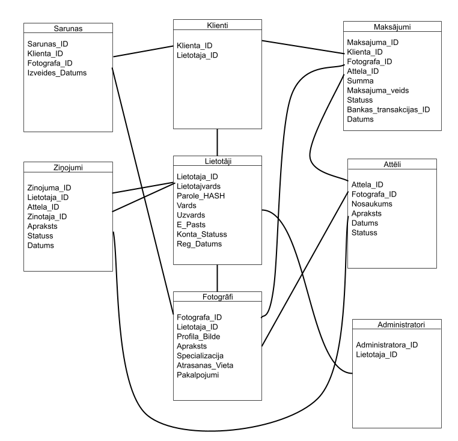

4. attēls. Datu atkarības diagramma

## 4. Saskarņu apraksts

### 4.1. Moduļu saskarnes

| Moduļa nosaukums | Sistēmas iestatījumu apakšmodulis                                                                                                                                       |
| ---------------- | ----------------------------------------------------------------------------------------------------------------------------------------------------------------------- |
| Ievaddati        | • Administratora identifikators • Izvēlētais darbības veids • Atjauninājumu faili/pakotnes                                                                        |
| Izvaddati        | • Sistēmas un datubāzes stāvokļa pārskats • Drošības žurnālu pārskats • Atjauninātās sistēmas skata atspoguļošana uz ekrāna • Paziņojums par veiksmīgu darbību |

| Moduļa nosaukums | Lietotāju pārvaldības apakšmodulis |
| --- | --- |
| Ievaddati | • Administratora identifikators • Sūdzības ziņojuma identifikātori • Lietotāju identifikatori vai • Attēlu identifikatori • Izvēlētais darbības veids |
| Izvaddati | • Ziņojumu saraksts un detaļas • Lietotāja informācija • Attēla informācija • Mainīto kontu vai attēlu statusu atspoguļošana uz ekrāna • Paziņojums par veiksmīgu darbību |

| Moduļa nosaukums | Autorizācijas apakšmodulis                                  |
| ---------------- | ----------------------------------------------------------- |
| Ievaddati        | • Lietotājvārds • Parole                                 |
| Izvaddati        | • Nekas • Kļūdas paziņojums par neveiksmīgu autorizāciju |

| Moduļa nosaukums | Reģistrācijas un konta pārvaldības apakšmodulis |
| --- | --- |
| Ievaddati | • Lietotājvārds • Parole • Vārds • Uzvārds • E-pasts • Maksājumu informācija • Lietotāja tips |
| Izvaddati | • Paziņojums par veiksmīgu reģistrāciju • Izcelti kļūdas paziņojumi par nepareizi aizpildītām sekcijām |

| Moduļa nosaukums | Meklēšanas modulis |
| --- | --- |
| Ievaddati | • Lietotāja rakstīts teksts, atslēgvārdi, filtri • Fotogrāfa specializācija • Atlasītais cenu diapazons • Fotogrāfa atrašanās vieta |
| Izvaddati | • Fotogrāfu saraksts • Fotogrāfa profila informācija • Kļūdas paziņojums, ja meklēšanas rezultāti nav atrasti |

| Moduļa nosaukums | Privātās komunikācijas modulis |
| --- | --- |
| Ievaddati | • Sarunas dalībnieka identifikators • Ziņas teksts • Sarunas identifikators |
| Izvaddati | • Saņemtās un nosūtītās ziņas • Sarunas vēsture • Paziņojums par jaunu ziņu vai pieprasījumu • Kļūdas paziņojums |

| Moduļa nosaukums | Fotogrāfu modulis |
| --- | --- |
| Ievaddati | • Fotogrāfa profila apraksts • Profila bilde • Kontaktinformācija • Fotogrāfa specializācija • Atrašanās vieta • Pakalpojumu informācija un cena |
| Izvaddati | • Pievienota vai atjaunota konta informācija • Paziņojums par veiksmīgu darbības izpildi • Kļūdas paziņojums |

| Moduļa nosaukums | Maksājumu veikšanas modulis |
| --- | --- |
| Ievaddati | • Maksājuma informācija • Maksājuma veids (ar pārskaitījumu vai ar karti) • Lietotāja personīgie dati maksājuma nodrošināšanai |
| Izvaddati | • Atjaunota informācija par maksājuma statusu • Paziņojums par veiksmīgu apmaksu • Kļūdas paziņojums |

| Moduļa nosaukums | Augšupielādes apakšmodulis |
| --- | --- |
| Ievaddati | • Augšupielādējamais attēla fails • Attēla nosaukums • Attēla kategorija • Attēla apraksts • Fotogrāfa identifikators |
| Izvaddati | • Augšupielādēts attēls • Attēla metadati • Pievienotā attēla atspoguļošana portfolio • Paziņojums par veiksmīgu augšupielādi • Kļūdas paziņojums par neatļautu faila tipu, izmēru vai citu kļūmi |

| Moduļa nosaukums | Lejupielādes apakšmodulis |
| --- | --- |
| Ievaddati | • Lietotāja identifikators • Attēla identifikātors • Vairāku attēlu lejupielādes pieprasījums • Pirkuma identifikators |
| Izvaddati | • Lejupielādes apstiprinājuma atspoguļošana uz ekrāna • Paziņojums par veiksmīgu lejupielādi • Kļūdas paziņojums |

### 4.2. Procesu saskarnes

| Procesa nosaukums | Datu bāzes uzturēšana un uzraudzīšana |
| --- | --- |
| Ievaddati | • DBVS darbības rādītāji • Administratora izvēlētā darbība |
| Izvaddati | • Datubāzes stāvokļa pārskats |

| Procesa nosaukums | Sistēmas drošības uzraudzīšana |
| --- | --- |
| Ievaddati | • Pieprasījums pēc sistēmas žurnālfailiem (logs) |
| Izvaddati | • Sistēmas žurnālfailu skats • Drošības notikumu pārskats • Brīdinājumi par aizdomīgām darbībām • Automātiskie brīdinājumi |

| Procesa nosaukums | Vietnes funkcionalitātas uzturēšana, atjaunināšana |
| --- | --- |
| Ievaddati | • Atjauninājuma pakotne vai jauna versija • Plānotais izpildes laiks |
| Izvaddati | • Atjauninātās sistēmas skata atspoguļošana uz ekrāna • Paziņojums lietotājiem par plānotajiem darbiem • Paziņojums par veiksmīgu atjaunināšanu • Kļūdas paziņojums |

| Procesa nosaukums | Ziņojumu saņemšana un pārskate |
| --- | --- |
| Ievaddati | • Lietotāja sūdzības ziņojuma identifikators • Ziņojumā norādītais lietotājs vai saturs |
| Izvaddati | • Ziņojuma informācijas pārskata izvade uz ekrāna • Sūdzības statusa atspoguļošana uz ekrāna |

| Procesa nosaukums | Lietotāja informācijas apskate |
| --- | --- |
| Ievaddati | • Lietotāja identifikators |
| Izvaddati | • Lietotāja profila un konta informācijas izvade uz ekrāna • Kļūdas paziņojums, ja lietotājs nav atrasts |

| Procesa nosaukums | Lietotāju konta īslaicīga darbības apturēšana |
| --- | --- |
| Ievaddati | • Lietotāja identifikators • Konta apturēšanas termiņš • Darbības iemesls |
| Izvaddati | • Paziņojums lietotājam par konta apturēšanu • Paziņojums par veiksmīgu konta apturēšanu |

| Procesa nosaukums | Lietotāju konta noņemšana no platformas |
| --- | --- |
| Ievaddati | • Lietotāja identifikators • Konta apturēšanas termiņš (neatgriezenisks) • Darbības iemesls |
| Izvaddati | • Paziņojums par veiksmīgu konta dzēšanu |

| Procesa nosaukums | Lietotāja satura īslaicīga blokēšana |
| --- | --- |
| Ievaddati | • Attēla identifikātors • Attēla blokēšanas termiņš • Darbības iemesls |
| Izvaddati | • Paziņojums fotogrāfam par attēla bloķēšanu • Paziņojums par veiksmīgu attēla bloķēšanu |

| Procesa nosaukums | Lietotāja satura pilnīga noņemšana no platformas |
| --- | --- |
| Ievaddati | • Attēla identifikātors • Attēla blokēšanas termiņš (neatgriezenisks) • Darbības iemesls |
| Izvaddati | • Paziņojums par attēla veiksmīgu izdzēšanu |

| Procesa nosaukums | Konta darbības atjaunošana |
| --- | --- |
| Ievaddati | • Lietotāja identifikātors • Apturēšanas termiņš (beigas) |
| Izvaddati | • Paziņojums lietotājam par konta darbības atjaunošanu • Paziņojums par veiksmīgu konta darbības atjaunošanu |

| Procesa nosaukums | Attēla atjaunošana |
| --- | --- |
| Ievaddati | • Attēla identifikātors • Bloķētā attēla termiņa beigas |
| Izvaddati | • Paziņojums fotogrāfam par attēla atjaunošanu • Paziņojums par veiksmīgu attēla atjaunošanu |

| Procesa nosaukums | Lietotāja autorizācija |
| --- | --- |
| Ievaddati | • Lietotājvārds • Parole |
| Izvaddati | • Nekas (Veiksmīga autorizācija) • Kļūdas paziņojums par neveiksmīgu autorizāciju |

| Procesa nosaukums | Lietotāja reģistrācija |
| --- | --- |
| Ievaddati | • Lietotājvārds • Parole • Vārds • Uzvārds • E-pasts • Maksājumu informācija • Lietotāja tips |
| Izvaddati | • Paziņojums par veiksmīgu reģistrāciju • Kļūdas paziņojums par neveiksmīgu reģistrāciju |

| Procesa nosaukums | Lietotāja dzēšana |
| --- | --- |
| Ievaddati | • Lietotāja indentifikators |
| Izvaddati | • Paziņojums par veiksmīgu konta dzēšanu • Kļūdas paziņojums par neveiksmīgu dzēšanas mēģinājumu (gadījumos, ja ir kāds aktīvs rēķins) |

| Procesa nosaukums | Fotogrāfu meklēšana |
| --- | --- |
| Ievaddati | • Lietotāja ievadītais meklēšanas teksts, atslēgvārdi |
| Izvaddati | • Fotogrāfu saraksta izvade uz ekrāna • Paziņojums, ja atbilstoši fotogrāfi nav atrasti |

| Procesa nosaukums | Fotogrāfu filtrēšana |
| --- | --- |
| Ievaddati | • Lietotāja ievadītais teksts, atslēgvārdi vai jau iegūts fotogrāfu saraksts • Specializācija (filtrs) • Atrašanās vieta (filtrs) • Cenu diapazons (filtrs) |
| Izvaddati | • Fotogrāfu saraksta izvade uz ekrāna • Paziņojums, ja atbilstoši fotogrāfi nav atrasti |

| Procesa nosaukums | Rezultātu apskate |
| --- | --- |
| Ievaddati | • Fotogrāfa identifikātors • Fotogrāfu dati • Kārtošanas secība |
| Izvaddati | • Fotogrāfa profila informācija • Kontaktinformācija • Iespējas uzsākt sarunu atspoguļošana uz ekrāna • Pakalpojumu saraksts ar cenām • Portfolio priekšskatījums |

| Procesa nosaukums | Fotogrāfa profila un portfolio apskate |
| --- | --- |
| Ievaddati | • Fotogrāfa identifikators |
| Izvaddati | • Portfolio satura izvade uz ekrāna • Attēlu izvade uz ekrāna • Attēlu papildinformācijas izvade uz ekrāna |

| Procesa nosaukums | Saziņas atlase |
| --- | --- |
| Ievaddati | • Fotogrāfa identifikātors |
| Izvaddati | • Nekas • Kļūdas paziņojums |

| Procesa nosaukums | Tērzētavas saziņa |
| --- | --- |
| Ievaddati | • Sarunas identifikators • Fotogrāfa identifikātors • Klienta identifikātors • Īsziņas teksts |
| Izvaddati | • Nosūtītā ziņas izvade uz ekrāna • Atjauninātas sarunas vēstures izvade uz ekrāna |

| Procesa nosaukums | Ziņojumu iesniegšana |
| --- | --- |
| Ievaddati | • Ziņojuma identifikātors • Sūdzības saturs |
| Izvaddati | • Paziņojums par veiksmīgu ziņojuma iesniegšanu • Kļūdas paziņojums par neveiksmīgu ziņojuma iesniegšanu |

| Procesa nosaukums | Pakalpojuma attēla augšupielāde |
| --- | --- |
| Ievaddati | • Attēla fails |
| Izvaddati | • Augšupielādēts attēls saziņas vidē • Paziņojums par veiksmīgu augšupielādi • Kļūdas paziņojums par neveiksmīgu augšuplādi |

| Procesa nosaukums | Maksājumu pieprasīšana |
| --- | --- |
| Ievaddati | • Klienta identifikātors • Maksājuma summa • Pakalpojuma apraksts |
| Izvaddati | • Izveidots maksājuma pieprasījuma izvade uz ekrāna • Paziņojums klientam par saņemtu maksājuma pieprasījumu |

| Procesa nosaukums | Attēlu augšupielāde |
| --- | --- |
| Ievaddati | • Attēla fails • Attēla nosaukums • Attēla apraksts |
| Izvaddati | • Augšupielādētā attēla izvade uz ekrāna • Paziņojums par veiksmīgu augšupielādi • Kļūdas paziņojums par neveiksmīgu augšuplādi |

| Procesa nosaukums | Profila satura pievienošana |
| --- | --- |
| Ievaddati | • Fotogrāfa profila informācija • Profila bilde • Apraksts • Kontaktinformācija • Cenas |
| Izvaddati | • Izveidotā fotogrāfa profila izvade uz ekrāna • Paziņojums par veiksmīgu datu saglabāšanu • Kļūdas paziņojums par neveiksmīgu datu saglabāšanu |

| Procesa nosaukums | Profila satura labošana |
| --- | --- |
| Ievaddati | • Fotogrāfa identifikātors • Labotā profila informācija |
| Izvaddati | • Atjauninātā fotogrāfa profila izvade uz ekrāna • Paziņojums par veiksmīgu datu saglabāšanu • Kļūdas paziņojums par neveiksmīgu datu saglabāšanu |

| Procesa nosaukums | Profila satura noņemšana |
| --- | --- |
| Ievaddati | • Fotogrāfa identifikātors • Profila saturs |
| Izvaddati | • Paziņojums par veiksmīgu noņemšanu • Kļūdas paziņojums par neveiksmīgu noņemšanu |

| Procesa nosaukums | Portfolio satura pievienošana |
| --- | --- |
| Ievaddati | • Fotogrāfa identifikātors • Attēla identifikātors • Attēla nosaukums • Attēla kategorija • Attēla apraksts |
| Izvaddati | • Pievienotā attēla atspoguļošana portfolio • Paziņojums fotogrāfam par veiksmīgu satura pievienošanu • Kļūdas paziņojums par veiksmīgu satura pievienošanu |

| Procesa nosaukums | Portfolio satura labošana |
| --- | --- |
| Ievaddati | • Attēla identifikātors • Atjauninātā attēla informācija |
| Izvaddati | • Atjauninātā attēla papildinformācijas atspoguļošana uz ekrāna • Paziņojums par veiksmīgu informācijas atjaunošanu • Kļūdas paziņojums par neveiksmīgu informācijas atjaunošanu |

| Procesa nosaukums | Portfolio satura dzēšana |
| --- | --- |
| Ievaddati | • Attēla identifikātors |
| Izvaddati | • Paziņojums par veiksmīgu dzēšanu • Kļūdas paziņojums par neveiksmīgu dzēšanu |

| Procesa nosaukums | Maksājuma veida atlase |
| --- | --- |
| Ievaddati | • Maksājuma pieprasījuma identifikators • Izvēlētais maksājuma veids |
| Izvaddati | • Izvēlētajam maksājuma veidam piedāvāta ievades formas attēlošana uz ekrāna |

| Procesa nosaukums | Informācijas ievade |
| --- | --- |
| Ievaddati | • Vārds • Uzvārds • E-pasts • Kartes vai bankas konta dati |
| Izvaddati | • Datu pārbaudes un apstiprinājuma izvade uz ekrāna • Kļūdas paziņojums par nekorekti aizpildītajiem laukiem |

| Procesa nosaukums | Samaksas veikšana |
| --- | --- |
| Ievaddati | • Maksājuma pieprasījuma identifikatos • Summa • Maksājuma dati |
| Izvaddati | • Bankas atbilde (noraidīts vai apstiprināts) • Paziņojums par veiksmīgu apmaksu • Kļūdas paziņojums |

| Procesa nosaukums | Pirkuma reģistrācija |
| --- | --- |
| Ievaddati | • Klienta identifikators • Fotogrāfa indetifikators • Bankas transakcijas identifikators |
| Izvaddati | • Piekļuves pie attēlu lejupielādes atspoguļošana uz ekrāna |

| Procesa nosaukums | Attēlu augšupielāde |
| --- | --- |
| Ievaddati | • Attēla fails • Attēla nosaukums • Attēla apraksts |
| Izvaddati | • Augšupielādēts attēla izvade uz ekrāna • Paziņojums par veiksmīgu augšupielādi • Kļūdas paziņojums par neveiksmīgu augšuplādi |

| Procesa nosaukums | Attēlu lejupielāde |
| --- | --- |
| Ievaddati | • Lietotāja identifikators • Attēla identifikators (vai vairāku attēlu) • Pirkuma identifikators |
| Izvaddati | • Ziņojums par veikmīgu lejupielādi vai lejupielādēm • Kļūdas paziņojums |

### 4.3. Lietotāja saskarnes

Šeit ir tikai ieteikumi. Programmētājs var brīvi interpretēt un nolemt mainīt dizainu, pievienot vai noņemt detaļas, ja to uzskata par nepieciešamu.

Krāsu izkārtojums piedāvāts melnbaltā variantā, ir tikai kā aptuvens uzmetums. Dizaina krāsu palete:

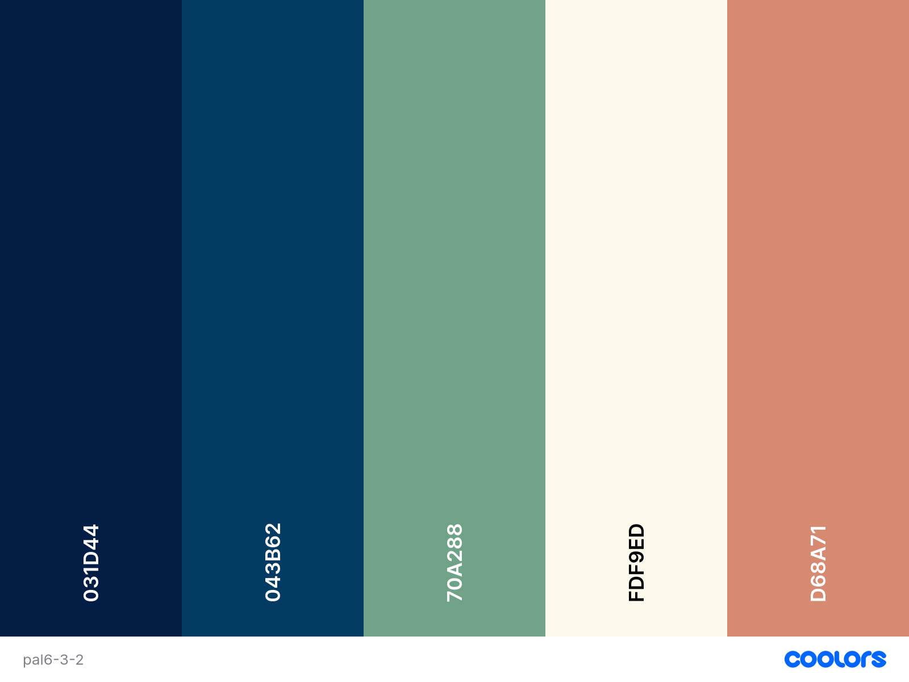

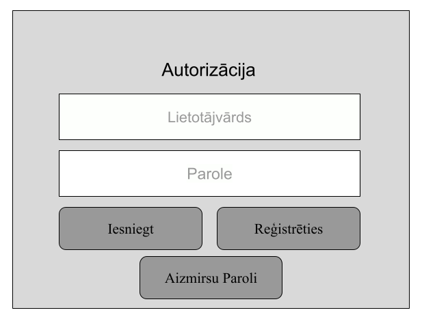

5. attēls. Autorizācijas forma

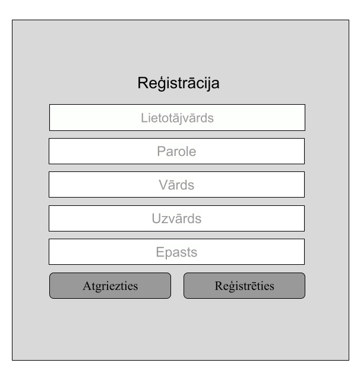

6. attēls. Reģistrācijas forma

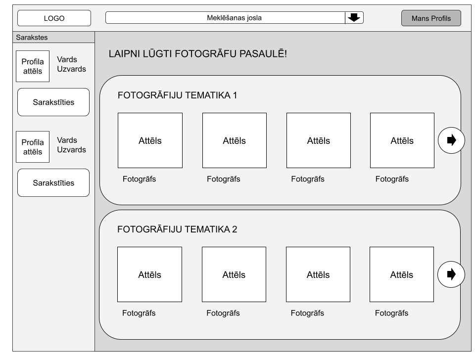

7. attēls. Vietnes sākumlapa

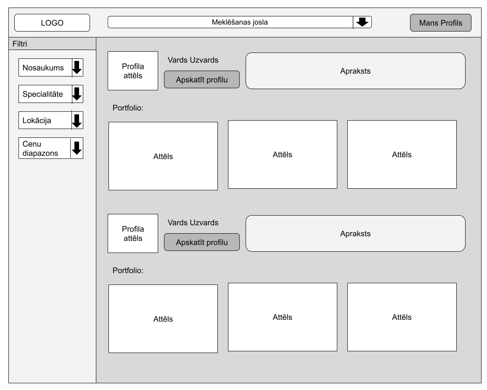

8. attēls. Meklēšanas rezultātu izvade

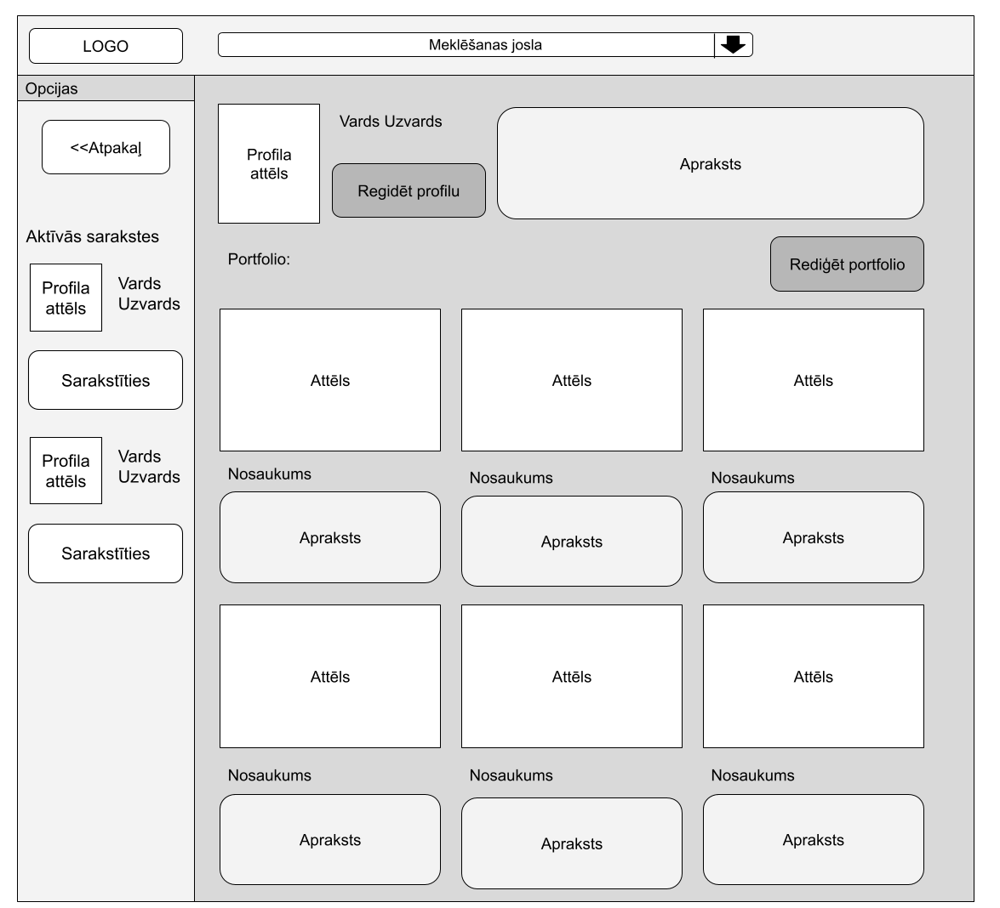

9. attēls. Fotogrāfa profila un portfolio skats (Fotogrāfa perspektīve)

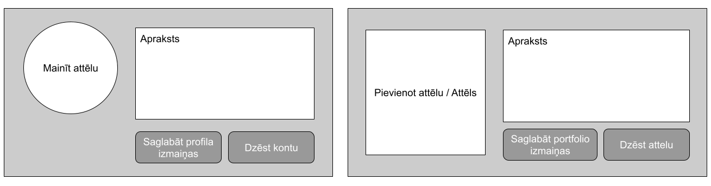

10. attēls. Profila un portfolio rediģēšanas logi

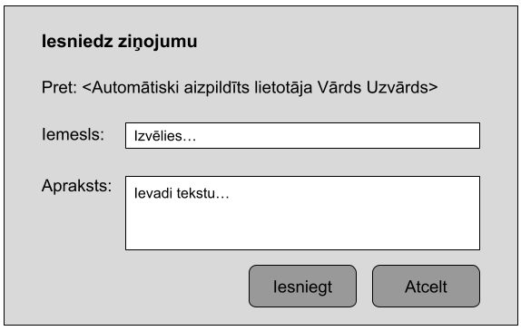

11. attēls. Sūdzības ziņojuma iesniegums

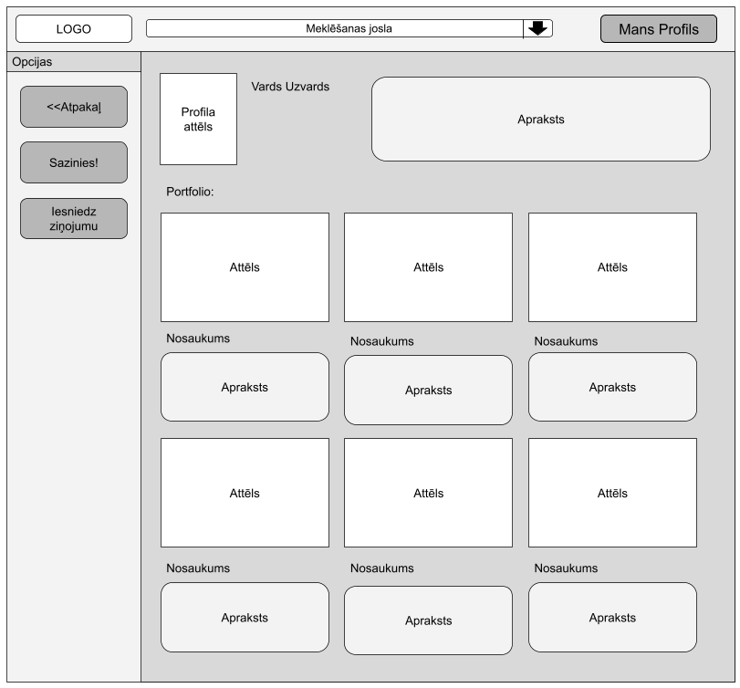

12. attēls. Fotogrāfa profila un portfolio skats (Klienta perspektīve)

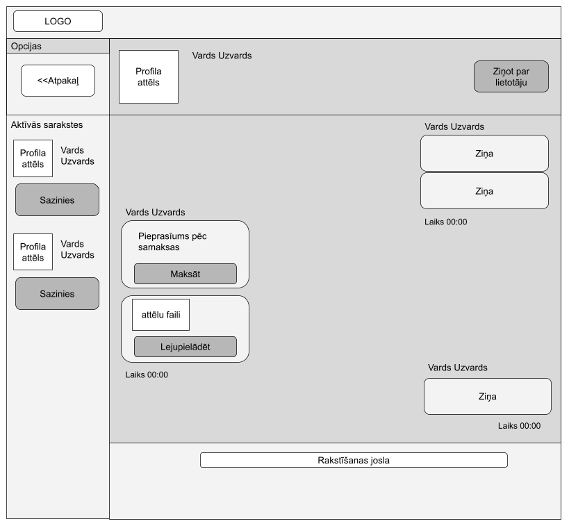

13. attēls. Tērzētavas saziņa (Klienta perspektīve)

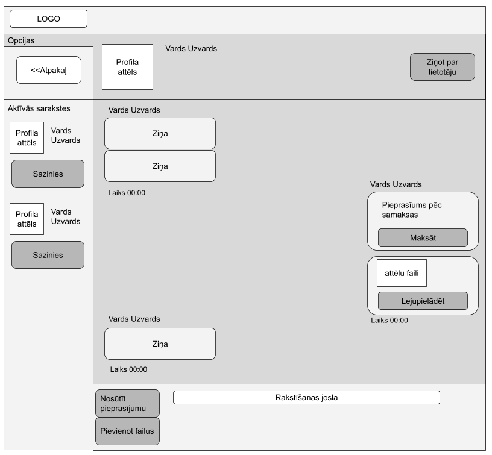

14. attēls. Tērzētavas saziņa (Fotogrāfa perspektīve)

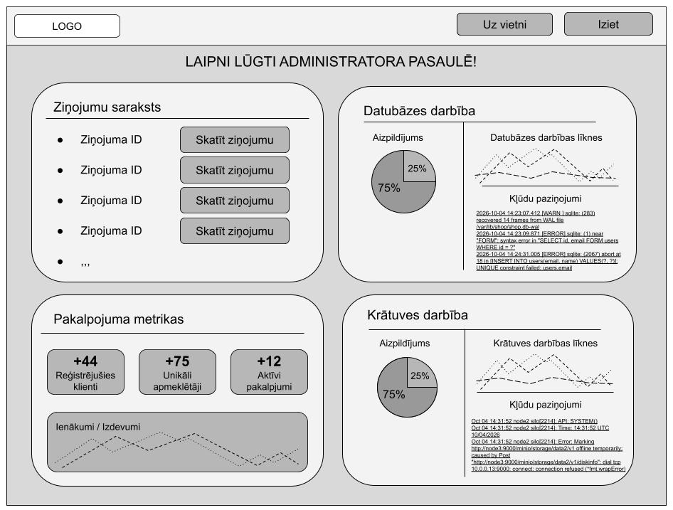

15. attēls. Administratora skats

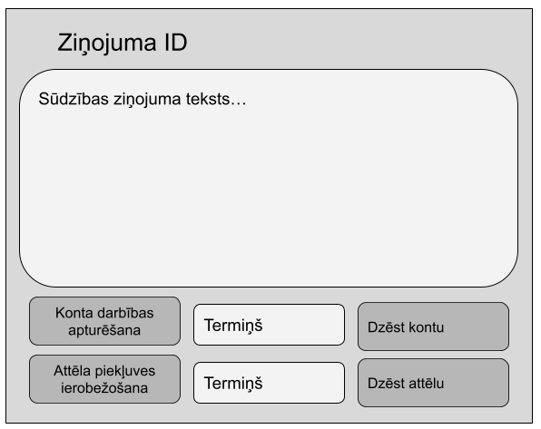

16. attēls. Ziņojuma paplašinātais skats

## 5. Detalizēts projektējuma apraksts

### 5.1. Moduļu detalizēts projektējums

#### 5.1.1. Lietotāja autorizācija

|   | Nosacījumi | 1 | 2 | 3 | 4 |
| --- | --- | --- | --- | --- | --- |
| C1 | Vai nospiesta poga “Iesniegt”? | 1 | 1 | 1 | - |
| C2 | Vai ir aizpildītas kolonas “lietotājvārds” un “parole”? | 0 | 1 | 1 | - |
| C2 | Vai ievadītais lietotājvārds un parole sakrīt ar datubāzē esošo? | - | 0 | 1 | - |
| C3 | Vai nospiesta poga “Reģistrēties”? | - | - | - | 1 |
|   | Darbības |   |   |   |   |
| D1 | Neaizpildītās kolonas iezīmējas sarkanas. | X |   |   |   |
| D2 | Izvadīt paziņojumu “Lietotājvārds vai parole nav pareizi!” |   | X |   |   |
| D3 | Piekļuve sistēmai pēc norādītās lomas |   |   | X |   |
| D4 | Atvert reģistrācijas skatu (5.1.2) |   |   |   | X |

#### 5.1.2. Lietotāja reģistrācija

|   | Nosacījumi | 1 | 2 | 3 | 4 |
| --- | --- | --- | --- | --- | --- |
| C1 | Vai nospiesta poga “Reģistrēties”? | 1 | 1 | 1 | - |
| C2 | Vai ievadīta derīga informācija? | 0 | 1 | 1 | - |
| C3 | Vai ievadītais lietotājvārds vai e-pasts sakrīt ar datubāzē esošo? | - | 0 | 1 | - |
| C4 | Vai nospiesta poga “Atgriezties”? | - | - | - | 1 |
|   | Darbības |   |   |   |   |
| D1 | Neaizpildītās vai nederīgās kolonas iezīmējas sarkanas. | X |   |   |   |
| D2 | Izvadīt paziņojumu “Verifikācija nosūtīta uz epastu”, nosūta verifikācijas epastu un sagatavo datus par jauna klienta pievienošanu datubāzei. |   | X |   |   |
| D3 | Izvadīt paziņojumu “Verifkācija nosūtīta uz epastu”, bet esošajam lietotājam nosūtīt brīdinājumu par reģistrēšanās mēģinājumu. |   |   | X |   |
| D4 | Atvert autorizācijas skatu (5.1.1.) |   |   |   | X |

#### 5.1.3. Sākumlapas navigācija

|   | Nosacījumi | 1 | 2 | 3 | 4 | 5 | 6 |
| --- | --- | --- | --- | --- | --- | --- | --- |
| C1 | Vai meklēšanas joslā apstiprināts ievadītais (nospiests Enter vai poga)? | 1 | 1 | - | - | - | - |
| C2 | Vai meklēšanas joslā ievadīts teksts? | 0 | 1 | - | - | - | - |
| C3 | Vai nospiesta poga “Mans Profils”? | - | - | 1 | - | - | - |
| C4 | Vai nospiesta poga “Sarakstīties”? | - | - | - | 1 | - | - |
| C5 | Vai noklikšķināts uz fotogrāfa attēla vai vārda? | - | - | - | - | 1 | - |
| C6 | Vai nospiesta bultiņa fotogrāfiju tematikas blokā? | - | - | - | - | - | 1 |
|   | Darbības |   |   |   |   |   |   |
| D1 | Izvada paziņojumu “Lūdzu ievadiet tekstu!” | X |   |   |   |   |   |
| D2 | Atvērt meklēšanas rezultātus, novirzīt uz 5.1.4. |   | X |   |   |   |   |
| D3 | Atvērt lietotāja profila skatu, iestatījumus |   |   | X |   |   |   |
| D4 | Atvērt saraksti ar izvēlēto lietotāju (5.1.6.) |   |   |   | X |   |   |
| D5 | Atvērt fotogrāfa profila skatu (5.1.5.) |   |   |   |   | X |   |
| D6 | Attēlot nākamos fotogrāfus, kas atbilst tematikai (paliek vēl sākumlapā) |   |   |   |   |   | X |

#### 5.1.4. Fotogrāfu meklēšana

|   | Nosacījumi | 1 | 2 | 3 | 4 |
| --- | --- | --- | --- | --- | --- |
| C1 | Vai ievadītais teksts atbilst kādam no meklēšanas kritērijiem? | 0 | - | 1 | - |
| C2 | Vai atlasīti filtrēšanas kritēriji? | 0 | - | 1 | - |
| C3 | Vai datubāzē ir atbilstošie fotogrāfi? | - | 0 | 1 | - |
| C4 | Vai ir nospiests uz kādu no atrasto fotogrāfu profiliem (vārda vai pogas)? | - | - | 0 | 1 |
|   | Darbības |   |   |   |   |
| D1 | Izvadīt paziņojumu “Ievadiet citus meklēšanas kritērijus vai filtrus!” | X |   |   |   |
| D2 | Izvadīt paziņojumu “Meklēšanas kritērijiem atbilstošie fotogrāfi netika atrasti!” |   | X |   |   |
| D3 | Izvadīt pēc kritērijiem atrasto fotogrāfu sarakstu |   |   | X |   |
| D4 | Pāriet uz fotogrāfa profilu (5.1.5.) |   |   |   | X |

#### 5.1.5. Profila skats (Klienta skats uz fotogrāfa profilu)

|   | Nosacījumi | 1 | 2 | 3 | 4 | 5 | 6 |
| --- | --- | --- | --- | --- | --- | --- | --- |
| C1 | Vai fotogrāfa profila sadaļā ir pievienota informācija (apraksts, bilde)? | 0 | 1 | - | - | - | - |
| C2 | Vai fotogrāfa portfolio ir pievienoti attēli? | 0 | 1 | 1 | - | - | - |
| C4 | Vai tiek nospiesta poga “Sazinies!”? | - | - | - | 1 | - | - |
| C3 | Vai tiek nospiesta poga “Atpakaļ”? | - | - | - | - | 1 | - |
| C5 | Tiek nospiesta poga “Iesniedz ziņojumu”? | - | - | - | - | - | 1 |
|   | Darbības |   |   |   |   |   |   |
| D1 | Izvada tukšu portfolio | X |   |   |   |   |   |
| D2 | Izvada fotogrāfa profila informāciju |   | X |   |   |   |   |
| D3 | Izvada fotogrāfa portfolio |   |   | X |   |   |   |
| D4 | Pāriet uz privātu tērzētavu (5.1.7.) |   |   |   | X |   |   |
| D5 | Atgriežas atpakaļ pie filtrētajiem rezultātiem (5.1.4.) |   |   |   |   | X |   |
| D6 | Atveras ziņojumu iesniegšanas lapa |   |   |   |   |   | X |

#### 5.1.6. Profila skats - Fotogrāfa profila un portfolio pārvaldība

|   | Nosacījumi | 1 | 2 | 3 | 4 | 5 | 6 | 7 | 8 | 9 | 10 | 11 | 12 |
| --- | --- | --- | --- | --- | --- | --- | --- | --- | --- | --- | --- | --- | --- |
| C1 | Vai nospiesta poga “Rediģēt profilu”? | 1 | 0 | 0 | 0 | 0 | 0 | 0 | 0 | 0 | 0 | 0 | 0 |
| C2 | Vai tiek pamainīts apraksta teksts zem 250 rakstzīmēm? | - | - | 0 | - | - | - | 0 | - | - | - | - | - |
| C3 | Vai tiek augšupielādēta saderīga formāta profilbilde? | - | - | - | 0 | - | - | 0 | - | - | - | - | - |
| C4 | Vai tiek nospiesta poga “Dzēst profilu”? | - | - | - | - | 1 | - | 0 | - | - | - | - | - |
| C5 | Vai tiek nospiesta poga “Saglabāt profila izmaiņas”? | - | 1 | - | - | - | 0 | 0 | - | - | - | - | - |
| C6 | Vai tiek nospiesta poga “Rediģēt portfolio”? | 0 | 0 | 0 | 0 | 0 | 0 | 1 | 0 | 0 | 0 | 0 | 0 |
| C7 | Vai tiek augšupielādēts saderīgs attēls? | 0 | - | - | - | - | - | - | - | - | 0 | - | - |
| C8 | Vai tiek pievienots aprakstošs, limita ievērojošs teksts pie attēla? | 0 | - | - | - | - | - | - | - | - | - | 0 | - |
| C9 | Vai tiek rediģēts attēla apraksts, ievērojot teksta limitu? | 0 | - | - | - | - | - | - | - | - | - | 0 | - |
| C10 | Vai tiek nospiesta poga “Dzēst attēlu”? | 0 | - | - | - | - | - | - | - | - | - | - | 1 |
| C11 | Vai tiek nospiesta poga “Saglabāt portfolio izmaiņas”? | 0 | - | - | - | - | - | - | 1 | 1 | - | - | - |
|   | Darbības |   |   |   |   |   |   |   |   |   |   |   |   |
| D1 | Atvērtas profila (Profilbilde, apraksts) rediģēšanas iespējas | X |   |   |   |   |   |   |   |   |   |   |   |
| D2 | Atjauno profila informāciju, pievieno datu bāzei, atgriežas profila skatā |   | X |   |   |   |   |   |   |   |   |   |   |
| D3 | Izvada paziņojumu “Apraksts nedrīkst pārsniegt 250 rakstzīmes!” |   |   | X |   |   |   |   |   |   |   |   |   |
| D4 | Izvada paziņojumu “Profilbildes tips netiek atbalstīts!” |   |   |   | X |   |   |   |   |   |   |   |   |
| D5 | Izdzēš fotogrāfa profilu no vietnes un datubāzes |   |   |   |   | X |   |   |   |   |   |   |   |
| D6 | Izvada paziņojumu “Vai vēlaties iziet nesaglabājot datus?” |   |   |   |   |   | X |   |   |   |   |   |   |
| D7 | Atveras portfolio rediģēšanas sadaļa |   |   |   |   |   |   | X |   |   |   |   |   |
| D8 | Augšupielāde attēlu un tā informāciju portfolio, saglabā datubāzē, atgriežas profila skatā |   |   |   |   |   |   |   | X |   |   |   |   |
| D9 | Atjauno attēla aprakstu, augšupielādē datubāzē, atgriežas profila skatā |   |   |   |   |   |   |   |   | X |   |   |   |
| D10 | Izvadīt paziņojumu “Šis attēla faila tips netiek atbalstīts!” |   |   |   |   |   |   |   |   |   | X |   |   |
| D11 | Izvada paziņojumu “Attēla apraksts nedrīkst pārsniegt 250 rakstzīmes!” |   |   |   |   |   |   |   |   |   |   | X |   |
| D12 | Izdzēš attēlu no portfolio un datubāzes |   |   |   |   |   |   |   |   |   |   |   | X |

#### 5.1.7. Tērzētava

|   | Nosacījumi | 1 | 2 | 3 | 4 | 5 | 6 | 7 | 8 |   |
| --- | --- | --- | --- | --- | --- | --- | --- | --- | --- | --- |
| C1 | Vai ir izvēlēts lietotājs, ar ko vēlas sazināties? | 0 | 1 | - | - | - | - | - | - | - |
| C2 | Vai otra lietotāja profils ir datubāzē? | - | 1 | 0 | - | - | - | - | - | - |
| C3 | Vai izvēlēts nosūtīt ziņu? | - | - | - | 1 | 1 | - | - | - | - |
| C4 | Vai ziņas teksts ir tukšs? | - | - | - | 1 | 0 | - | - | - | - |
| C5 | Vai izvēlēta funkcija “Ziņot par lietotāju”? | - | - | - | - | - | 1 | - | - | - |
| C6 | Vai izvēlēta funkcija “Nosūtīt pieprasījumu”? (Fotogrāfs) | - | - | - | - | - | - | 1 | - | - |
| C7 | Vai izvēlēta funkcija “Pievienot failus”? (Fotogrāfs) | - | - | - | - | - | - | - | 1 | - |
| C8 | Vai izvēlēta funkcija “Maksāt”? | - | - | - | - | - | - | - | - | 1 |
|   | Darbības |   |   |   |   |   |   |   |   |   |
| D1 | Attēlot aktīvo sarunu sarakstu un izvadīt paziņojumu “Izvēlaties sarunu no saraksta” | X |   |   |   |   |   |   |   |   |
| D2 | Ielādēt un attēlot divu lietotāju sarunas vēsturi. |   | X |   |   |   |   |   |   |   |
| D3 | Izvadīt paziņojumu “Saziņa ar šo lietotāju nav iespējama” |   |   | X |   |   |   |   |   |   |
| D4 | Izvadīt paziņojumu “Ziņa nevar būt tukša” |   |   |   | X |   |   |   |   |   |
| D5 | Nosūtīt ziņu, saglabāt to. |   |   |   |   | X |   |   |   |   |
| D6 | Atvērt sūdzības formu un reģistrē to datubāzē |   |   |   |   |   | X |   |   |   |
| D7 | Atvērt maksājuma pieprasījuma formu |   |   |   |   |   |   | X |   |   |
| D8 | Atvērt attēla augšupielādes bloku |   |   |   |   |   |   |   | X |   |
| D9 | Atvērt maksāšanas formu |   |   |   |   |   |   |   |   | X |

#### 5.1.8. Administratora darbību skats

|   | Nosacījumi | 1 | 2 | 3 | 4 |
| --- | --- | --- | --- | --- | --- |
| C1 | Vai tiek nospiesta kāda no “Skatīt ziņojumu” pogām? | 1 | 0 | 0 | 0 |
| C2 | Vai tika nospiesta poga “Uz vietni”? | 0 | 1 | 0 | 0 |
| C3 | Vai tiek uzpiests kāds no kļūdu paziņojumiem? | 0 | 0 | 1 | 0 |
| C4 | Vai tiek nospiesta poga “Iziet”? | 0 | 0 | 0 | 1 |
|   | Darbības |   |   |   |   |
| D1 | Atveras konkrēta sūdzības ziņojuma logs ar to saistīto informāciju | X |   |   |   |
| D2 | Atveras vietnes sākumlapas skats, pieslēdzoties ar administratora kontu |   | X |   |   |
| D3 | Atveras kļūdu ziņojuma paplašinājums |   |   | X |   |
| D4 | Iziet no administratora paneļa |   |   |   | X |
